<!--
  The source of every CBR how-to guide. See README.md beside this file.

  Sections only some readers need are wrapped in a guide tag naming a capability:

    write        Inspector Level 1 and up - record inspections, edit sites and structures
    destructive  Inspector Level 2 and up - add sites and structures, delete, archive
    approve      PENG and Inspector Reviewer - sign off inspections
    review       Inspector Reviewer - mark inspections Reviewed
    admin        Administrator

  Prefix a name with ! for everyone without it (!admin). Tags do not nest. Untagged text is in
  every guide. This comment is in every guide's source but
  renders to nothing.
-->

# How to use the Corporate Bridge Register

## About this guide

CBR records the bridges and major culverts on the resource road network, and the inspections,
repairs and monitoring that keep them safe. What you can do in it depends on the roles you hold.
Each inspector role includes everything the roles above it can do:

| Role | View and run reports | Record inspections; edit sites and structures | Add sites and structures; delete; archive | Sign off inspections | Mark Reviewed; set items Required | Edit the bulletin |
| --- | :---: | :---: | :---: | :---: | :---: | :---: |
| View All | ✓ | | | | | |
| Inspector Level 1 | ✓ | ✓ | | | | |
| Inspector Level 2 | ✓ | ✓ | ✓ | | | |
| PENG | ✓ | ✓ | ✓ | ✓ | | |
| Inspector Reviewer | ✓ | ✓ | ✓ | ✓ | ✓ | |
| Administrator | ✓ | | | | | ✓ |

## Getting around

1. Sign in with your IDIR.
2. The **Dashboard** opens first. Any notice from the CBR administrators appears there.
3. Use the menu on the left to reach each part of CBR. Select a section to open its pages, and
   select it again to close them:
   - **Inventory** - Site Search and Structure Search
   - **Inspection** - Inspection Search
   - **Reports** - the eleven CBR reports
<!-- guide: admin -->
   - **Administration** - Bulletin Message
<!-- /guide -->
4. Under **Support** at the foot of the menu: **How-to guide** opens this document, and **Report an
   issue** opens an email to Team Heartwood, who maintain CBR.

<!-- guide: !admin -->
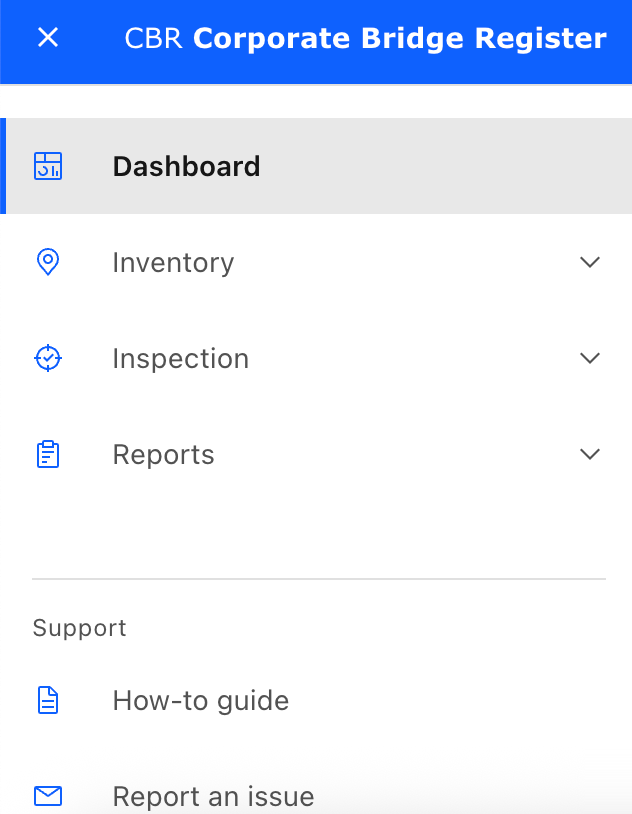
<!-- /guide -->
<!-- guide: admin -->
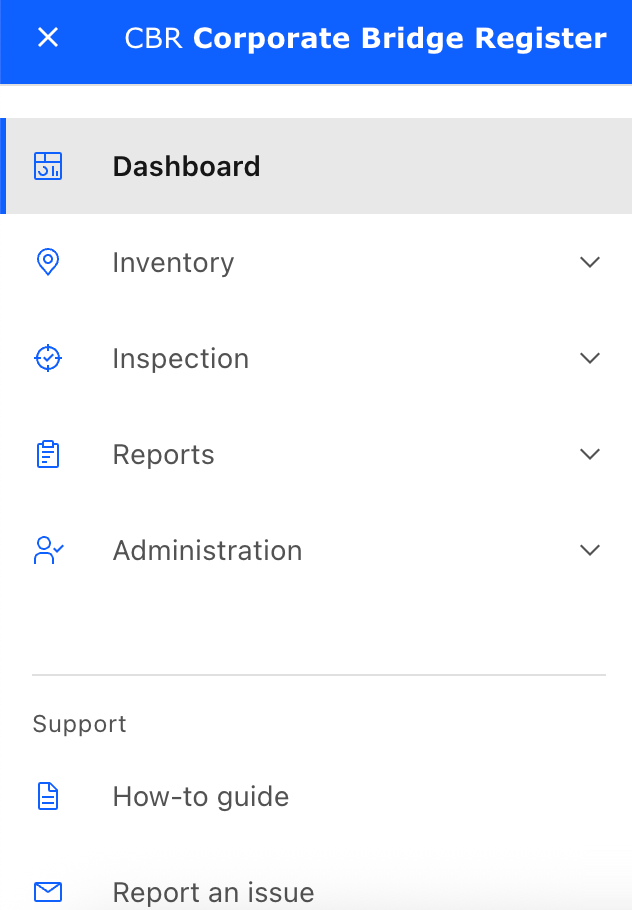
<!-- /guide -->
<!-- guide: !write -->
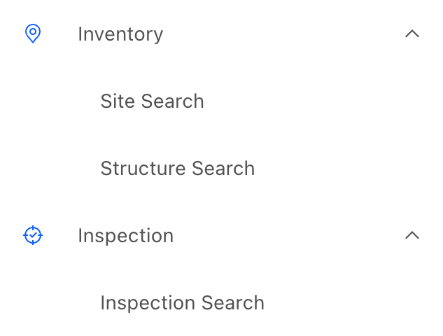
<!-- /guide -->
<!-- guide: write+!destructive -->
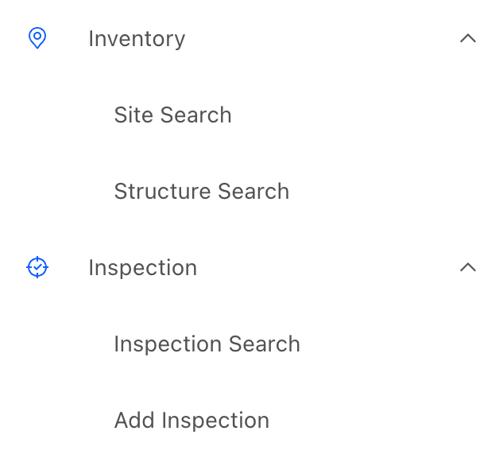
<!-- /guide -->
<!-- guide: destructive -->
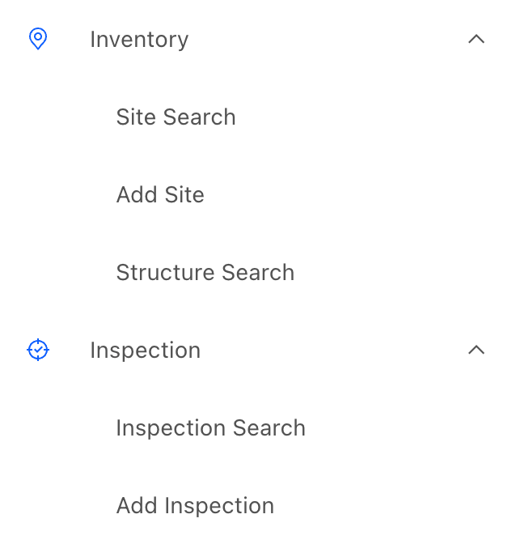
<!-- /guide -->

On a narrow screen the menu folds away; open it with the menu button at the top left.

## Finding a site or structure

1. Open **Inventory > Site Search** or **Inventory > Structure Search**.
2. Fill in the search fields and search.
3. Select a result to open its page.

A structure's page is arranged in tabs: **Information**, **Details**, **Spans & Piers** (bridges),
**Documents & Photos**, **Inspections**, **Repairs** and **Monitoring**. The site's page lists the
structures at the crossing.

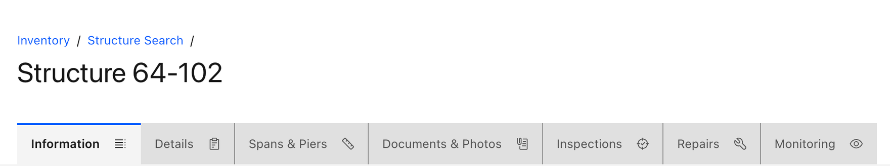

## Finding an inspection

1. Open **Inspection > Inspection Search**, or the **Inspections** tab of a structure.
2. Select an inspection to open it.

An inspection's page has the tabs **Inspection**, **Condition**, **Hydraulic Hazards**, **Documents &
Photos**, **Repairs** and **Monitoring**.

Every inspection has a status:

| Status | Meaning |
| --- | --- |
| In Progress | Being recorded; not yet finished |
| Submitted | Finished by the inspector, waiting for a professional engineer |
| Reviewed | Signed off. No further changes |
| Rejected | Sent back by a professional engineer. No further changes |
| Accepted | An older equivalent of Reviewed, on historical inspections only |

## Running a report

1. Open **Reports** and choose a report.
2. Fill in the criteria it asks for, and run it.

The reports cover the structure inventory, structure detail, repairs, monitors, inspections
conducted, inspections due, a blank inspection form for use in the field, and replacement
structures.

<!-- guide: write -->
## Recording an inspection

You can start an inspection two ways:

- **Inspection > Add Inspection**, then choose the structure, or
- on a structure's **Inspections** tab, **Add routine inspection** or **Add unplanned inspection**.

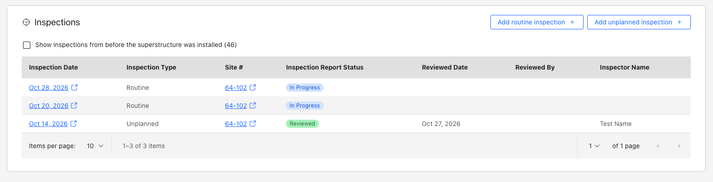

A structure must be complete before it can be inspected. While anything is missing, a notice above
the tabs says how many items are outstanding and on which tabs, and each of those tabs - Information,
Details or Inspections - shows a count. Open a tab with a count: its **Outstanding in this tab**
list names each missing field and the card it is on. Fill them in with that card's **Edit** button.
If you choose **Add routine inspection** or **Add unplanned inspection** before then, CBR shows
**Inspection cannot be added** and the counts turn red.

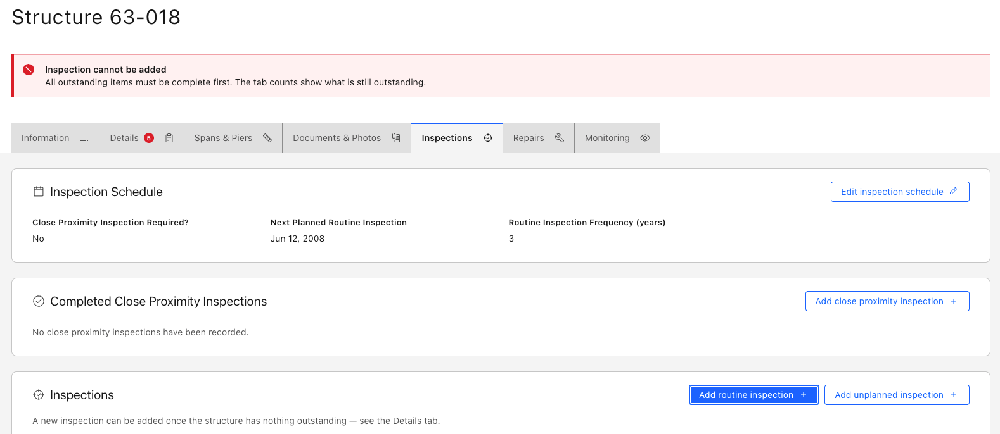

1. Choose the inspection type and status, and enter the inspection details.
2. Save it **In Progress** to come back to it later, or **Submitted** when it is finished.
   Submitting needs the inspection date, the inspector's name and their company.
3. Once it is saved, open each tab of the inspection to record the rest:
   - **Condition** - the answers for each part of the structure
   - **Hydraulic Hazards** - the water-related hazards at the crossing
   - **Repairs** and **Monitoring** - the work and watching the structure needs
   - **Documents & Photos** - upload photos and supporting documents
4. Each card on a tab has its own **Edit** or **Add** button. Make the change and save that card.

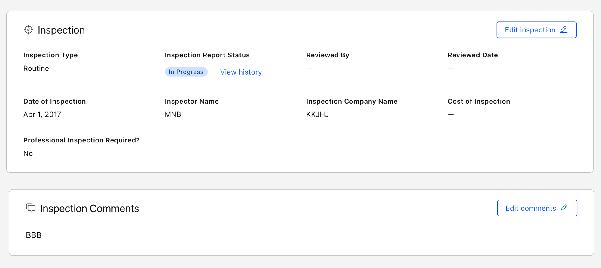

You can keep changing an inspection until it is Reviewed or Rejected.

## Editing a site or structure

1. Open the site or structure.
2. Choose **Edit** on the card you want to change, make the change, and choose **Save changes**.
   **Cancel** leaves the card as it was.

Fields marked with a red asterisk are required. If a value is not accepted, the field is outlined in
red and the reason appears beneath it.

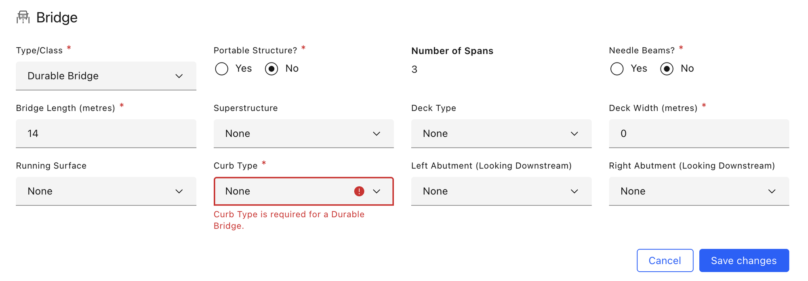
<!-- /guide -->

<!-- guide: destructive -->
## Adding a site or structure

- **Inventory > Add Site** creates a new crossing.
- On a site's page, **Add Structure** adds a structure to it.

## Deleting and archiving

Level 2 and above can delete sites, structures, inspections, and the repairs, monitoring items and
documents under them, and archive a structure that is no longer in use. CBR asks you to confirm
before anything is removed.

**Deleting cannot be undone.** Archive a structure rather than delete it when its history should be
kept.
<!-- /guide -->

<!-- guide: approve -->
## Signing off inspections

As a professional engineer you sign off inspections that inspectors have submitted.

1. Find Submitted inspections with **Inspection > Inspection Search**.
2. Open the inspection and check what was recorded on each tab.
3. To send it back, choose **Edit inspection** on the **Inspection** tab, set **Inspection Report
   Status** to **Rejected**, and save. Marking it **Reviewed** is the Inspector Reviewer's step
   (next section, if your copy includes it).
4. Add your remarks with **Edit PEng comments** on the same tab. Only professional engineers see
   this button.

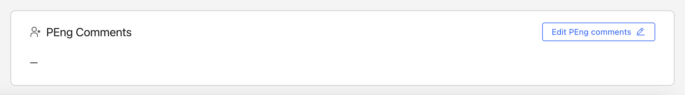

Once an inspection is Reviewed or Rejected, its page no longer offers changes.
<!-- /guide -->

<!-- guide: review -->
## Marking an inspection Reviewed

1. Open the Submitted inspection and check it.
2. On the **Inspection** tab, choose **Edit inspection**, set **Inspection Report Status** to
   **Reviewed**, and save.
3. The **Review inspection** dialog opens. In it:
   - **Load rating** - enter the **Current Load Rating GVW** and choose a **Load Rating Reason**
     (both required), and tick **Load Rating Review Required** if it needs one.
   - **Structure life** - check the structure's age and its design-life, restriction and replacement
     years. These are shown, not changed, here.
   - **Inspection schedule** - set the **Routine Inspection Frequency** and the **Next Planned
     Inspection Date** (both required).

   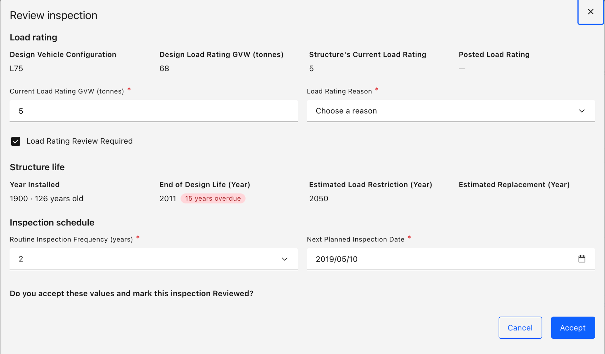

4. Choose **Accept**. The inspection becomes **Reviewed**, with you as its reviewer and today as the
   review date, and the structure takes the values you confirmed.
5. On the inspection's **Repairs** tab, choose **Edit** on each suggested repair, set **Repair
   Status** to **Required** or **Not Required**, and choose **Save**. Monitoring items on the
   **Monitoring** tab work the same way. Only Inspector Reviewers are offered these two statuses.

   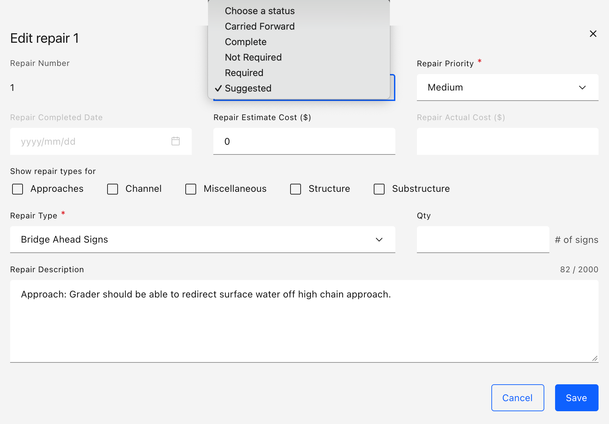

Only you can mark an inspection Reviewed under your name; CBR records whoever does it.
<!-- /guide -->

<!-- guide: admin -->
## Administration

The **Administration** menu holds the **Bulletin Message**: a notice shown on every user's
Dashboard. Use it for planned outages, changes to the inspection process, and similar.

1. Open **Administration > Bulletin Message**.
2. Type the message. Basic formatting is kept - paragraphs, line breaks, bold, italic, lists and
   links - and the **Preview** beside it shows how it will look, up to 2,000 characters.
3. Choose **Save**. It appears on the Dashboard.

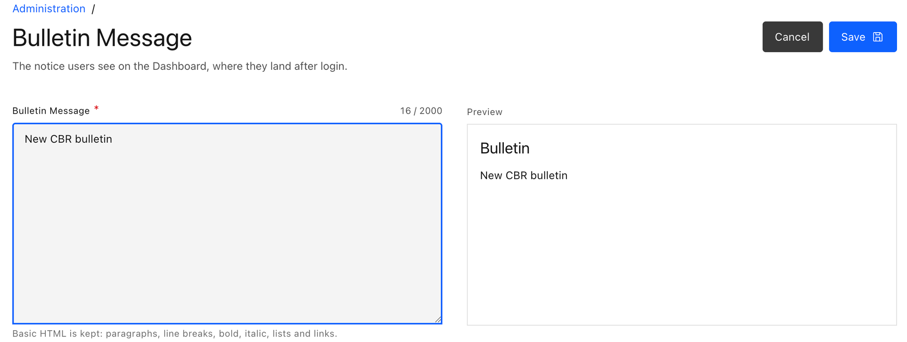

Administrators can search and view everything in CBR, but cannot change sites, structures or
inspections unless they also hold an inspector role.

Who holds which CBR role, including Inspector Reviewer, is managed in FAM, not in CBR. Send role
requests to your FAM administrator.
<!-- /guide -->

## Getting help

Choose **Report an issue** under **Support** in the menu. Say what you were doing, what you
expected, and what happened instead; a screenshot helps.
